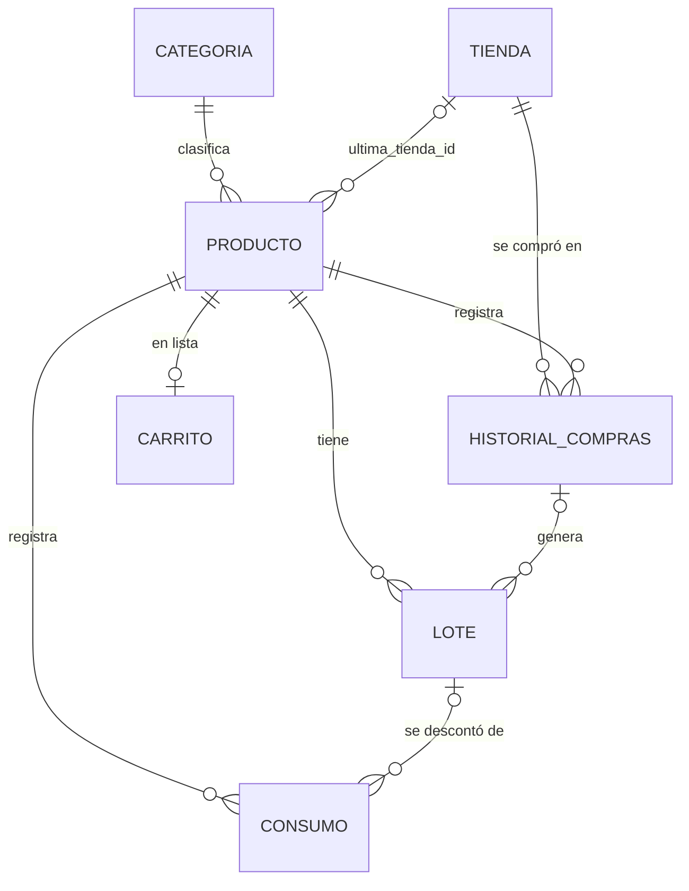

# 🫙 Alacena — Práctica 2: Base de Datos LOCAL

Aplicación Flutter para la gestión de inventario doméstico (alacena) con persistencia local en **SQLite (sqflite)**. Controla existencias por lotes, alerta sobre productos caducados, por caducar, agotados o por agotarse, y mantiene la trazabilidad de compras por tienda.

## Cómo ejecutarla

El repositorio contiene el código (`lib/`, `test/`, `pubspec.yaml`). Las carpetas de plataforma se generan con Flutter:

```bash
# 1. Generar carpetas android/ e ios/ (no sobrescribe lib/ ni test/)
flutter create --org com.alacena --project-name alacena --platforms=android,ios .

# 2. Configurar desugaring, permisos y receivers de notificaciones
dart run tool/configurar_plataformas.dart

# 3. Dependencias y ejecutar
flutter pub get
flutter run
```

> Requiere Flutter 3.27 o superior. La primera vez se crea la base de datos con datos de ejemplo (categorías, tiendas y productos con fechas relativas a hoy) para que la app ya muestre alertas en la presentación.

<details>
<summary>Si prefieres configurar Android a mano (en lugar del paso 2)</summary>

En `android/app/build.gradle.kts`:

```kotlin
android {
    compileOptions {
        isCoreLibraryDesugaringEnabled = true
        // ...lo que ya tenía
    }
}
dependencies {
    coreLibraryDesugaring("com.android.tools:desugar_jdk_libs:2.1.4")
}
```

En `android/app/src/main/AndroidManifest.xml`, dentro de `<manifest>`:

```xml
<uses-permission android:name="android.permission.POST_NOTIFICATIONS"/>
<uses-permission android:name="android.permission.RECEIVE_BOOT_COMPLETED"/>
```

y dentro de `<application>`:

```xml
<receiver android:exported="false" android:name="com.dexterous.flutterlocalnotifications.ScheduledNotificationReceiver" />
<receiver android:exported="false" android:name="com.dexterous.flutterlocalnotifications.ScheduledNotificationBootReceiver">
    <intent-filter>
        <action android:name="android.intent.action.BOOT_COMPLETED"/>
        <action android:name="android.intent.action.MY_PACKAGE_REPLACED"/>
    </intent-filter>
</receiver>
```
</details>

## Requerimientos cubiertos

| Requerimiento | Dónde |
|---|---|
| Listado principal de artículos próximos a caducar o por agotarse, con imagen | `screens/alertas_screen.dart`, `widgets/producto_card.dart` |
| Calendario con `table_calendar`, un punto por cada producto con alerta en el día | `screens/calendario_screen.dart` (`markerBuilder`) |
| Clic en un día → modal a pantalla completa con los artículos del día | `screens/dia_modal.dart` (`showGeneralDialog`) |
| Identificación rápida del estatus (caducado, sin existencia, por caducar, por agotarse) | `utils/estatus_ui.dart`: color + icono + etiqueta, barra lateral de color en cada tarjeta |
| Alta de artículo seleccionando categoría | `screens/producto_form_screen.dart` (categoría obligatoria) |
| Botón para agregar al carrito desde el listado principal | `ProductoAlertaCard` |
| Icono de carrito arriba a la derecha con contador (`badges`) | `CarritoBadgeButton` en `widgets/comunes.dart` |
| CRUD de categorías, tiendas, artículos, lotes, compras y carrito | `screens/` |
| Campo para alarmas locales y pantalla de productos que caducan ese día | `producto.notificar` + `producto.hora_alarma`; `services/notificaciones_service.dart`; `screens/caducan_hoy_screen.dart` |
| Slivers para listas y grids | Todas las pantallas usan `CustomScrollView` con `SliverAppBar`, `SliverList`, `SliverGrid`, `SliverFillRemaining` |

## Reglas de negocio

**FEFO (First Expired, First Out).** Un producto tiene varios lotes con su propia fecha de caducidad. Al consumir, `InventarioRepository.consumir()` recorre los lotes en orden de caducidad más próxima (los que no caducan van al final) y descuenta en una sola transacción. La hoja de "Consumir" muestra antes de confirmar de qué lote saldrá cada unidad.

**Agotado.** El stock total es `SUM(cantidad)` de los lotes con `cantidad > 0`. Si es 0 o no hay lotes, el producto está *Sin existencia*.

**Trazabilidad de tiendas.**
- *Histórico global:* en el detalle del producto se listan todas las tiendas donde se ha comprado, con número de compras, unidades, última fecha y precio promedio/mínimo (se marca la de mejor precio).
- *Última compra:* el trigger `trg_compra_ultima_tienda` actualiza `producto.ultima_tienda_id` en cada `INSERT` en `historial_compras`. Si se borra una compra, `trg_compra_borrada` la recalcula.

## Base de datos



**Integridad de dominio:** `NOT NULL`, `UNIQUE` (nombres de categoría y tienda sin distinguir mayúsculas, un producto una sola vez en el carrito), `CHECK` para cantidades (`> 0` / `>= 0`), precios no negativos, lista cerrada de unidades, motivo de consumo, días de aviso 0–60, formato `yyyy-MM-dd` de fechas y `HH:mm` de hora.

**Integridad referencial** (`PRAGMA foreign_keys = ON`):

| Relación | Al borrar el padre |
|---|---|
| producto → categoria | `RESTRICT` (la app avisa cuántos productos tiene) |
| historial_compras → tienda | `RESTRICT` (no se pierde la trazabilidad) |
| producto.ultima_tienda_id → tienda | `SET NULL` |
| lote, historial_compras, carrito, consumo → producto | `CASCADE` (se confirma antes) |
| lote.compra_id → historial_compras | `SET NULL` (el lote se conserva) |
| consumo.lote_id → lote | `SET NULL` |

## Funcionalidad extra

**Control de desperdicio y gasto.** Cada salida de la alacena se registra como *consumo* o *desecho* (tabla `consumo`). La pantalla de Estadísticas muestra el porcentaje de desperdicio de los últimos 30 días, lo que más se echa a perder, el valor estimado del inventario y el gasto por tienda. Además, desde el carrito se marca un artículo como "Comprado" y se registra la compra con su lote en un paso, y la lista se puede copiar para mandarla por WhatsApp.

## Widgets nuevos usados

`SegmentedButton` (consumo / desecho), `Dismissible` (deslizar para quitar del carrito), `Hero` (imagen del artículo al abrir el detalle), `ExpansionTile` (historial de compras), `SearchBar` (búsqueda en la alacena), `Slider` (días de aviso), `FlexibleSpaceBar` con imagen, `Badge` de Material en la barra de navegación, `showGeneralDialog` con transición deslizante.

## Estructura

```
lib/
  db/            database_helper.dart (esquema, triggers, datos de ejemplo)
  models/        categoria, tienda, producto, lote, compra, carrito_item, evento_calendario, estatus
  repositories/  catálogo, producto, inventario (FEFO, compras), carrito, estadísticas
  services/      notificaciones (alarmas locales), imágenes
  state/         alacena_provider.dart (Provider)
  screens/       alertas, calendario + modal del día, alacena, detalle, formularios, carrito, categorías, tiendas, estadísticas, caducan hoy, más
  widgets/       componentes compartidos
tool/            configurar_plataformas.dart
test/            pruebas de las reglas de estatus
```

## Probar las alarmas en la presentación

En **Más → Probar alarma** se lanza al instante la notificación del día; al tocarla se abre la pantalla *Caducan hoy*. Las alarmas reales se programan para cada lote que caduca, a la hora configurada en el artículo, y se reprograman cada vez que cambian los datos.
